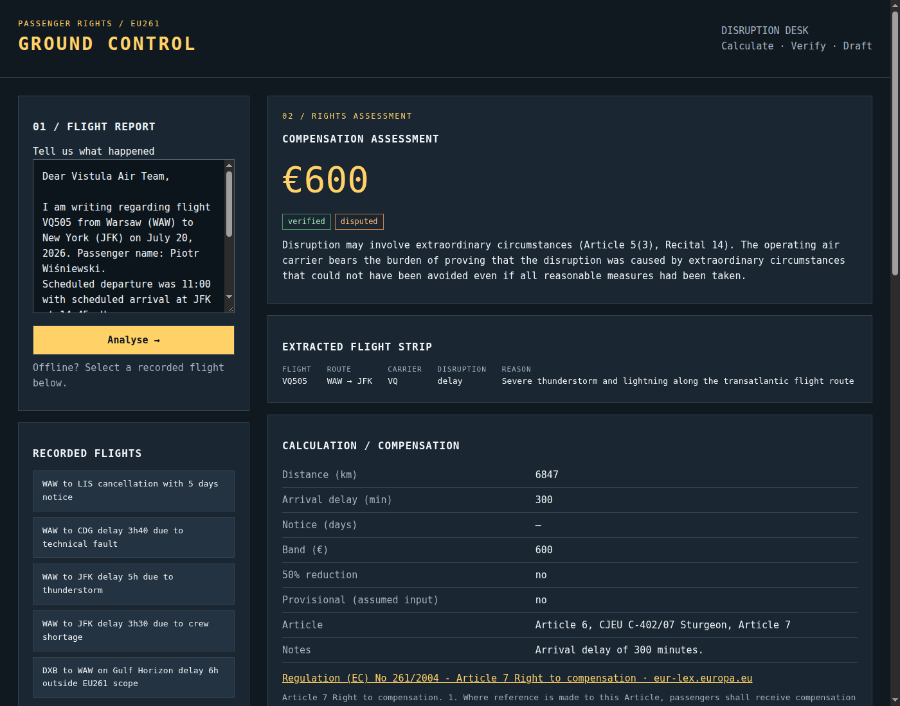

# GroundControl

**Your flight was cancelled or delayed. GroundControl works out what EU261 owes you, proves every
line against official EU sources, and drafts the claim to the airline and the complaint to the
enforcement body.**



The language model never decides the money. NVIDIA Nemotron (via Nebius Token Factory) reads the
passenger's messy text and writes the prose. Pure Python rules calculate distance, delay bands,
the 50 % reduction and care rights. Tavily then searches only allow-listed official domains
(EUR-Lex, CURIA, europa.eu, the Polish ULC) for the exact anchor of each rule, such as `EUR 600` or
the Sturgeon judgment. **No proof, no claim:** an entitlement without both a calculation and an
official source is shown as `unverified`, and the drafts say so in words.

## Try it (offline, no keys)

Requires Python 3.12+.

```bash
python3 -m venv .venv && .venv/bin/pip install -e . pytest
.venv/bin/python -m groundcontrol.web        # http://127.0.0.1:8000 (set PORT to change)
```

Pick one of the five recorded flights on the left:

| Flight | Result |
|---|---|
| WAW → LIS, cancelled 5 days before departure | €400, verified |
| WAW → CDG, 3 h 40 min delay, technical fault | €250, verified |
| WAW → JFK, 5 h delay, thunderstorm | €600, **disputed** (extraordinary circumstances) |
| WAW → JFK, 3 h 30 min delay, crew shortage | €300 (50 % reduction, Art. 7(2)) |
| DXB → WAW on a non-EU carrier | Outside EU261 scope, with the reason |

The command line does the same thing:

```bash
.venv/bin/python -m groundcontrol.demo --offline                        # all five scenarios
.venv/bin/python -m groundcontrol.demo --offline --scenario delay-3h40  # one claim letter
.venv/bin/pytest -q                                                     # full test suite
```

Offline mode replays the Nemotron and Tavily responses stored in `fixtures/`. Every call the
five scenarios make was recorded from the real APIs (`recorded: true`): Nemotron on Nebius
Token Factory and Tavily searches restricted to official EU domains. The few files marked
`recorded: false` are hand-written stand-ins for unit tests (for example, a model reply that
is not valid JSON, to exercise the retry). `scripts/record_fixtures.py` re-records them. In offline mode, free text that has no stored
fixture returns HTTP 409.

## Hosted demo

Vercel (primary): `app.py` is the zero-config FastAPI entrypoint and forces `LIVE=0`, so the hosted demo answers only from the recorded fixtures and needs no API keys or environment variables; `vercel.json` bundles `groundcontrol/` and `fixtures/`. Deploy with `vercel deploy` (preview) from the repo root.

Alternative, a build for Hugging Face Spaces: `scripts/build_space.sh /tmp/space` then push that folder to a Docker Space. Local check: `docker build -t groundcontrol . && docker run --rm -p 7860:7860 groundcontrol`.

## Hosted live demo (judges)

Replay is open to everyone. Live analysis of your own disruption text needs the code
from the Devpost testing instructions. Enter it in “Live mode” and click Unlock;
the HttpOnly session lasts 30 days. The Vercel demo remains replay-only.

Run the Docker image as one long-lived container with a persistent volume mounted
at `/data`, and enable `LIVE`. The server reads credentials from its environment.
Environment variables: `LIVE`, `JUDGE_CODE`, `NEBIUS_API_KEY`, `TAVILY_API_KEY`,
`LIVE_DAILY_CAP`, `DATA_DIR`, `PORT`, `NEBIUS_BASE_URL`, `NEMOTRON_MODEL`.

Docker defaults: port 7860, `DATA_DIR=/data`, non-root user (UID 1000). Ensure the
mounted disk is writable by that user. Sessions, failed unlock attempts and the
UTC daily run counter persist on disk. The default cap is 300 live runs per day;
failed processing attempts also count. A reached cap returns 429 and replay stays
available. Locked live requests return 401; the eleventh failed unlock per IP in
an hour returns 429. Missing keys or code disables live access. Provider failures
return a generic 502; failed source verification returns an unverified assessment.

Deploy behind a trusted reverse proxy that overwrites `X-Forwarded-For` and
`X-Forwarded-Proto`, since these determine the client IP and Secure cookie flag.
Do not enable body logging or fixture recording for hosted requests. Web requests
always suppress fixture recording. `/api/config` exposes only availability and
this request’s unlock state. Recorded flight selection always uses replay.

To re-record fixtures from the real APIs: `LIVE=1 .venv/bin/python scripts/record_fixtures.py`
(`--dry-run` lists the calls without making them).

## How it works

```
passenger text ─► 1 extract   Nemotron → FlightFacts (strict JSON, one retry, airport codes validated)
               ─► 2 assess    groundcontrol/eu261.py: pure code; distance, bands, Art. 5/6/7/8/9
               ─► 3 verify    Tavily on allow-listed domains; evidence must contain the rule's anchor
               ─► 4 draft     claim + complaint; a guard strips any euro amount the model invents
```

Rules, statuses and scenario definitions are in [docs/ARCHITECTURE.md](docs/ARCHITECTURE.md).

All data is synthetic and every airline is fictional. GroundControl only produces drafts. It
never sends anything to an airline or an authority. It is not legal advice.

## License

[MIT](LICENSE)
